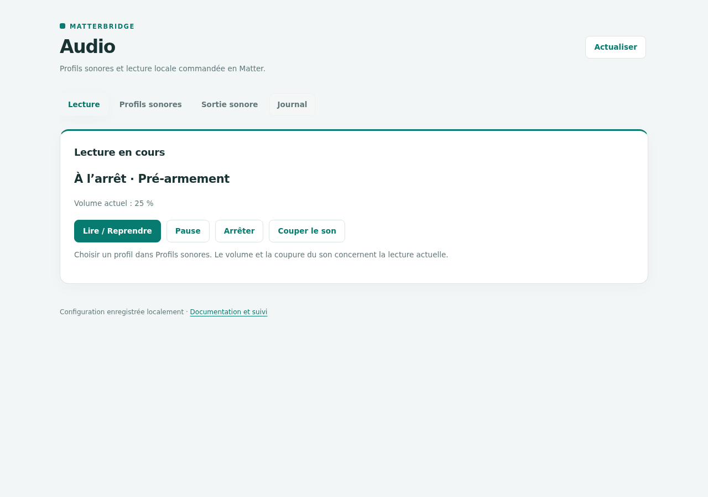

# Matterbridge Audio

[](https://github.com/macjl/matterbridge-audio/actions/workflows/ci.yml)

**Préversion 0.3.0-alpha.1 · Apache-2.0 · Matterbridge ≥ 3.11.2 · Node.js 24 recommandé**

Un lecteur audio local commandé en Matter, utilisable par une alarme ou par tout autre contrôleur compatible. FFmpeg produit le son ; Matter transporte les commandes, pas les échantillons audio.



## Fonctionnement

- Profils nommés avec son (bip bref, tonalité, sirène), volume, répétition et durée maximale.
- Lecture, pause, reprise, arrêt, volume et coupure du son via Media Playback et Speaker.
- Lancer un profil remplace la lecture en cours. Renommer un profil conserve son identifiant et les actions qui l’utilisent.
- Le lecteur reste arrêté après redémarrage. Aucun son ne démarre automatiquement.
- Une durée de 0 permet la lecture jusqu’à l’arrêt ou au lancement d’un autre profil.

Le volume courant et la coupure du son concernent le Speaker. Lancer un profil réapplique son volume et respecte la coupure globale du son. Les modifications d’un profil s’appliquent au prochain lancement.

## Configuration

Depuis la page du plugin, créer les profils dans Profils sonores et sélectionner la sortie ALSA dans Sortie sonore. Les commandes courantes sont dans Lecture ; le journal présente les commandes reçues depuis le démarrage.

Pour l’utiliser avec [Alarme](https://github.com/macjl/matterbridge-alarm), partager ce pont au contrôleur de l’alarme. Créer des actions « Lire un profil », puis une action « Arrêter la lecture » au désarmement et au retour à l’état armé.

Le lecteur conserve les types Basic Video Player et Speaker. Le catalogue des profils utilise une convention d’application sur Content Launcher : le marqueur FixedLabel `audioProfiles=v1`, une recherche `Any="*"`, `AutoPlay=false` et `Data="audio-profiles.v1:OFFSET"` retournent une page JSON `{kind,profiles,next}` limitée à 800 octets. La lecture du catalogue est silencieuse. Le lancement utilise l’identifiant du profil et `AutoPlay=true`. Cette convention n’est pas un catalogue natif de la norme Matter.

Les fichiers audio personnels et la diffusion audio réseau ne sont pas implémentés. L’exposition des commandes dans les interfaces des contrôleurs dépend de leur prise en charge de ces types d’appareils.

## Installation locale

```sh
git clone https://github.com/macjl/matterbridge-audio.git
cd matterbridge-audio
# Enregistrer le dossier dans une installation Matterbridge existante :
matterbridge --add "$PWD"
```

Le nom technique du plugin reste **`matterbridge-audio-poc`** pour conserver les données et identités du prototype installé. La page est `/plugins/matterbridge-audio-poc/` sur le serveur web Matterbridge. Se connecter à Matterbridge avant de l’ouvrir ; aucune clé supplémentaire n’est requise. Les API sont protégées par Matterbridge et une version antérieure à 3.11.2 est refusée.

FFmpeg doit être installé dans le PATH, avec une sortie ALSA disponible sur Linux. Dans Docker, transmettre `/dev/snd` au conteneur.

## Docker

```sh
docker build -t matterbridge-audio:local .
docker compose up -d --no-build
```

L’image est basée sur Matterbridge 3.11.2 et utilise un volume `/data`. Ne pas supprimer ce volume : il contient notamment les jumelages. HTTP écoute sur 8284 et Matter sur UDP 5545 par défaut. `POC_HTTP_BIND`, `POC_HTTP_PORT`, `POC_MATTER_PORT`, `POC_MDNS_INTERFACE` et `POC_DATA_DIR` restent les paramètres de déploiement compatibles avec le prototype.

Pour réunir les trois plugins dans un conteneur, cloner les trois dépôts côte à côte et utiliser `scripts/build-stack.sh` du dépôt Alarme, puis les overrides `compose.stack.yaml` des dépôts Audio et Clavier. Chaque plugin fonctionne aussi seul. Les images ne contiennent ni code PIN, ni clé privée, ni configuration personnelle.

## Développement et validation

```sh
npm ci
npm run check
npm test
npm pack --dry-run
```

La CI vérifie les sources, les tests et le contenu du paquet avec Node.js 24. Matterbridge fournit ses API à l’exécution ; conformément à ses contraintes, le plugin ne déclare pas Matterbridge ou matter.js dans ses dépendances. Les tests des interfaces utilisent un contrôleur simulé ; les essais Matter réseau utilisent des conteneurs et un stockage jetables. Ils n’accèdent pas à l’installation réelle.

Les tests réseau s’exécutent avec `AUDIO_TEST_IMAGE=matterbridge-audio:local bash test/run.sh`. Les tests de profils avec l’alarme nécessitent la pile complète et `AUDIO_TEST_IMAGE=matterbridge-stack:local bash test/run-profiles.sh`. Ils mesurent la sortie PCM et remplacent la sortie matérielle par des fichiers, sans jouer de son sur la machine.

Cette préversion sert à poursuivre les essais. Les scénarios matériels et la configuration de production restent à valider sur l’installation cible.
